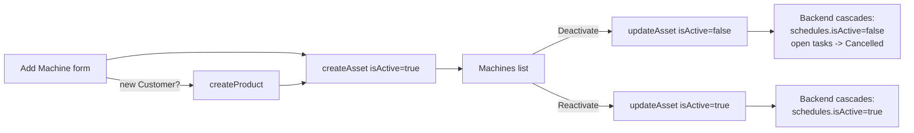

# Spec — Add / Manage Machines page

## Goal
Split machine (Asset) creation out of Create PM into its own page, and add the
ability to deactivate machines no longer in use (cascading to their PM plans),
with reactivation supported later.

## Decisions (confirmed with user)

| Topic | Decision |
|---|---|
| Create PM inline auto-create | **Removed.** Create PM becomes select-only (existing active Customer + Machine). |
| New route | `pm-machines` (nav label "Machines"), section "PM Work", same permissions as Create PM (`pm.create.view` route guard, `pm.create.submit` for mutations). |
| Form fields | Customer (existing via dropdown, or type new), Department, Machine ID, Machine Name. |
| Machine ID | Free-typed by user, must be unique (same as today). |
| After create | Stay on page, reset form, machine appears in the list below. |
| Machine list | Full manage: view + edit (Name, Department, Customer) + Deactivate/Reactivate. **No hard delete.** |
| Deactivate cascade | Stops future PM generation (schedule paused) **and** cancels any not-yet-`Done` tasks (`Pending`/`In Progress`/`Pending Approval`/`Overdue`) for that machine. `Done` tasks and all history are untouched — never deleted, always traceable. |
| Reactivate | Machine + its PM schedules resume together (one action). Previously-cancelled tasks stay cancelled (history). |
| Visibility of inactive machines | Hidden from active pickers (Create PM asset dropdown). Still shown (e.g. greyed/badge) in the new Machines manage list, and still appear in Reports/Audit for historical trace. |
| Backend readiness | Backend likely doesn't support `isActive`/cascade yet. Spec it in `docs/backend_machine_active_status.html` for the backend team. Frontend built against the intended contract now. |
| Frontend testability before backend ships | Add a dev-only **mock data mode** (same pattern as `pm-reports.component.ts`'s `isDevBuild` mock preview) so "create machine" and "deactivate machine" can be exercised end-to-end locally without the live backend, gated behind `!environment.production`. |

## Data model changes

- `Asset.isActive?: boolean` — optional, defaults to `true` when absent (same convention as `User.isActive`).
- `PMSchedule.isActive?: boolean` — new, optional, defaults to `true`. `false` = paused, no new tasks generated.
- `PMTaskStatus` gains `'Cancelled'`. New optional `PMTask.cancelledReason?: string`, `cancelledAt?: Date`.

## Flow

## Frontend changes

1. **`pm.model.ts`**: add `isActive?` to `Asset`; add `isActive?` to `PMSchedule`; add `'Cancelled'` to status union + `cancelledReason?`/`cancelledAt?` on `PMTask`.
2. **`api.service.ts`**: add `updateAsset(id, patch: { name?, department?, location?, isActive? }): Promise<Asset>` → `PATCH /assets/:id`.
3. **`pm.service.ts`**:
   - `activeAssets` computed = `assets().filter(a => a.isActive !== false)`.
   - `updateAsset()` — permission-gated (same check as `createAsset`), calls api, patches local `assetsSignal`, and (cascade side-effect, mirrored locally for immediate UI feedback) when `isActive` flips to `false`, locally marks that asset's schedules `isActive=false` and cancels its own not-Done tasks in the local signals too — so the UI reflects the cascade immediately even before a page refresh confirms the backend did it.
   - Dev-only mock helpers for local testing (gated `!environment.production`), mirroring the `pm-reports` mock-preview pattern — lets a user create a "MOCK-" machine and deactivate it to see the full cascade in the UI without hitting the live backend.
4. **`pm-create.component.ts`**: use `pmService.activeAssets()` instead of `pmService.assets()` in `availableAssets()`; delete the `isNewProduct`/`isNewAsset` auto-create block from `submitForm()` — block submit with a clear error if the chosen product/asset doesn't exist instead.
5. **New page `pages/pm-machines/`**: `pm-machines.component.ts/.html/.scss` — Add-machine form (reusing the existing `ms-dropdown` pattern for Customer, typeahead like Create PM's asset field) + machines table (Customer, Machine ID, Name, Department, Status badge, Edit/Deactivate-Reactivate actions). Edit is inline or small modal, same visual language as existing modals (e.g. Save Template modal in Create PM).
6. **`app.routes.ts`**: add `pm-machines` route.
7. **`layout.component.html`**: add nav item under PM Work, gated by `pm.create.view`.
8. **`translation.service.ts`**: Thai strings for all new labels.

## Backend spec doc

`docs/backend_machine_active_status.html` (new) — documents required backend changes:
- `Asset.isActive` column (default `true`), returned by `GET /assets`.
- `PMSchedule.isActive` column (default `true`).
- `PMTaskStatus` gains `Cancelled` value + `cancelledReason`/`cancelledAt` columns.
- `PATCH /assets/:id` endpoint: accepts `{ name?, department?, location?, isActive? }`; on `isActive: false`, transactionally cascades to schedules (`isActive=false`) and open tasks (`status='Cancelled'`); on `isActive: true`, cascades schedules back to `isActive=true`; never touches `Done`/already-`Cancelled` tasks.
- Should write an `AuditLog` entry for create/deactivate/reactivate/edit (matches existing audit pattern).

## Out of scope
- Hard delete of machines.
- Deactivating a whole Customer/Product (only machine-level for now).
